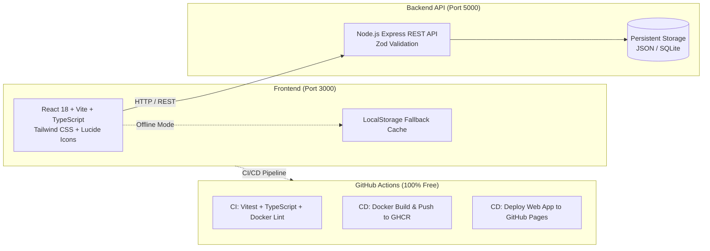

# 🚀 CareerPulse — Career Improvement & Daily Progress Tracker

[](https://github.com/yuvanesh18/career-todo-list/actions/workflows/ci.yml)
[](https://github.com/yuvanesh18/career-todo-list/actions/workflows/cd-ghcr.yml)
[](https://github.com/yuvanesh18/career-todo-list/actions/workflows/deploy-pages.yml)
[](https://www.docker.com/)
[](https://opensource.org/licenses/MIT)

> An advanced, production-ready Full-Stack Daily Progress and Career Milestone Tracking system for engineers. Built with React 18, TypeScript, Tailwind CSS, Node.js Express, Docker, and an automated GitHub Actions CI/CD pipeline using **100% free resources**.

---

## 🌟 Key Features

### 1. 🎯 Short-Term Goals (in Months)
- **Month-Based Goal Tracking**: Set concrete 1-month, 2-month, 3-month, or 6-month career targets (e.g., "Become Cloud & DevOps Job Ready in 2 Months", "Crack Full-Stack Interviews in 3 Months").
- **Live Goal Countdown**: Real-time progress bar displaying current day in goal, total days, and days remaining.
- **Multiple Roadmaps**: Manage active goals, completed goals, and pause/switch goals at any time.

### 2. 📋 Daily Actionable To-Do List
- **Quick-Add Input**: Add tasks for today in seconds with target due date, estimated hours, and priority level.
- **Satisfying Check-offs**: Interactive completion with celebration confetti and automatic goal progress updates.
- **Focused Views**: Filter between *Today's To-Do*, *All Roadmap Tasks*, and *Completed*.

### 3. 📖 Daily Status Check-in & Journal ("Keep Track")
- **Daily Status Updates**: Log what you accomplished today, key learnings, and obstacles encountered.
- **Daily Hours & Focus Tracker**: Record study/building hours and energy levels (High, Steady, Low).
- **Progress Journal**: A persistent timeline to review your daily consistency and effort over the months.
- **Consistency Streak**: Flame badge tracking active daily streaks.

### 4. 🔒 Reliability & Offline Sync

- **Backend Mode**: REST API powered by Node.js + Express with atomic JSON/SQLite persistence.
- **Offline / Static Mode**: Automatic fallback to browser `localStorage` when backend is offline or when deployed statically on GitHub Pages.
- **Export & Import**: Instant 1-click JSON backup and restore.

---

## 🏗️ Architecture & Tech Stack



---

## ⚡ Quick Start (Local Development)

### Prerequisites

- [Node.js](https://nodejs.org/) (v20+ recommended)
- [Git](https://git-scm.com/)
- (Optional) [Docker Desktop](https://www.docker.com/products/docker-desktop/)

### Option 1: Run with NPM (No Docker needed)

1. **Install dependencies**:

   ```bash
   # In backend
   cd backend
   npm install

   # In frontend
   cd ../frontend
   npm install
   ```
2. **Start Backend**:

   ```bash
   cd backend
   npm run dev
   # Server runs on http://localhost:5000
   ```
3. **Start Frontend** (in a second terminal):

   ```bash
   cd frontend
   npm run dev
   # App runs on http://localhost:3000
   ```
4. **Run Automated Tests**:

   ```bash
   # Test Backend
   cd backend && npm test

   # Test Frontend
   cd ../frontend && npm test
   ```

---

## 🐳 Running with Docker

Run the entire full-stack application with a single command:

```bash
docker compose up --build -d
```

- **Frontend App**: [http://localhost:3000](http://localhost:3000)
- **Backend API**: [http://localhost:5000/api/tasks](http://localhost:5000/api/tasks)
- **Health Check**: [http://localhost:5000/health](http://localhost:5000/health)

To view logs or stop:

```bash
docker compose logs -f
docker compose down
```

---

## 🔄 Free CI/CD Pipeline (GitHub Actions)

This project includes a continuous integration and delivery pipeline using **free tier resources**:

| Workflow                       | Trigger             | Free Resource                    | What It Does                                                                                 |
| :----------------------------- | :------------------ | :------------------------------- | :------------------------------------------------------------------------------------------- |
| **`ci.yml`**           | Push / Pull Request | GitHub Hosted Ubuntu Runners     | Runs Vitest unit & integration tests, TypeScript compile check, and Docker build test.       |
| **`cd-ghcr.yml`**      | Push to `main`    | GitHub Container Registry (GHCR) | Automatically builds multi-stage Docker images and pushes to `ghcr.io` under your account. |
| **`deploy-pages.yml`** | Push to `main`    | GitHub Pages                     | Automatically bundles and deploys the live web app for free.                                 |

👉 **Read the step-by-step CI/CD tutorial: [CICD_GUIDE.md](file:///c:/Users/Admin/Desktop/To-do-list/CICD_GUIDE.md)**

---

## 📡 REST API Reference

| Method     | Endpoint                    | Description                                                                         |
| :--------- | :-------------------------- | :---------------------------------------------------------------------------------- |
| `GET`    | `/health`                 | Health check endpoint for Docker & orchestrators                                    |
| `GET`    | `/api/tasks`              | Get all tasks (supports `?category=`, `?priority=`, `?status=`, `?search=`) |
| `GET`    | `/api/tasks/:id`          | Get single task details                                                             |
| `POST`   | `/api/tasks`              | Create a new career goal                                                            |
| `PUT`    | `/api/tasks/:id`          | Update status, subtasks, notes, or hours                                            |
| `DELETE` | `/api/tasks/:id`          | Remove a task                                                                       |
| `POST`   | `/api/tasks/:id/pomodoro` | Log a 25m Pomodoro session to task                                                  |
| `GET`    | `/api/analytics`          | Get streak, completion %, and category breakdowns                                   |
| `POST`   | `/api/seed`               | Reset database to initial sample career roadmap                                     |
| `GET`    | `/api/export`             | Export tasks backup JSON                                                            |
| `POST`   | `/api/import`             | Import tasks from JSON                                                              |

---

## 📄 License

MIT © 2026. Built for engineers advancing their careers.
